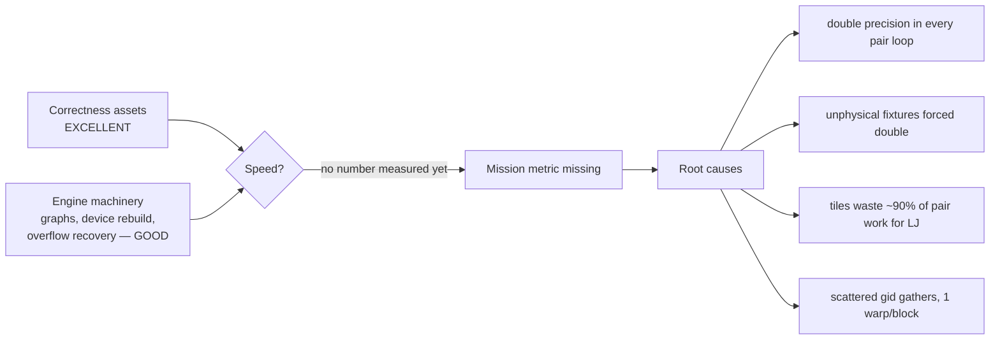
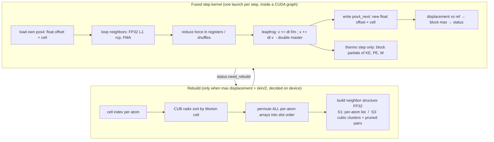
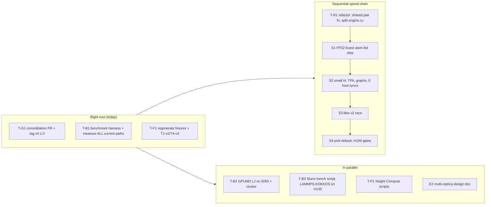

# TileMD — Review #1 and Plan v2 ("Speed phase")

> **For:** the Cursor coding agent. **From:** the reviewer (Claude), who holds decision authority for this project.
> **Commit as:** `docs/REVIEW_AND_PLAN_v2.md`. From now on this file **supersedes** `docs/PLAN.md` wherever they disagree. Keep `PLAN.md` for history; add a line at its top: "Superseded in part by docs/REVIEW_AND_PLAN_v2.md".
> **Reviewed state:** branch `m8-pair-attention-api`, commit `b2916fb` (76 commits), 2026-10-19.

---

## 0. The mission (read this first, every time)

TileMD exists to be **dramatically faster** than GPUMD and LAMMPS at MD. Correctness is a precondition, not the goal.
Every task in this plan must answer one question: **does it bring a measured atom-steps/s number closer to the target?**
If a task does not, it waits.

Targets (LJ melt, §8 of PLAN.md, FP32 force path):

| GPU | N | Must reach | Stretch |
|---|---|---|---|
| RTX 3050 (dev box) | 256k | ≥ 2× GPUMD LJ on the same card | ≥ 2×10⁸ atom-steps/s |
| RTX 3050 | 32k | ≥ 3× GPUMD LJ | — |
| H100 | 2M | ≥ LAMMPS-KOKKOS | ≥ 3×10⁹ atom-steps/s |
| H100 | 32k | ≥ 5× GPUMD LJ | — |

---

## 1. Review summary



### 1.1 Strengths (keep and build on)

| # | Strength | Evidence |
|---|---|---|
| S1 | Outstanding correctness infrastructure: double-precision oracle, 7 fixtures, LAMMPS references | EAM `Cu_u3` forces 1.4e-13 vs LAMMPS; CuNi setfl 1.5e-15; 100-step NVE within 1e-14 Å |
| S2 | Determinism achieved (bitwise 10 000-step reruns) | T6 passed |
| S3 | Hard engine machinery already works: Morton sort, device-side rebuild decision, CUDA graphs with conditional rebuild node, tail graphs, snapshot-based overflow recovery, device thermo ring | M4/M6 reports |
| S4 | **Cell-local float shadow (D17)** is a genuinely good idea: offset from a cell of edge 4 + packed cell index | 9.1e-6 error at box L≈270 vs 1.6e-3 for absolute float |
| S5 | Real bugs found and fixed by tests (Morton stencil vs linear cells; CSR rows overwritten) | commits `9e86e0d`, M5 report |
| S6 | Generic pair-attention API already runs LJ and two EAM formats | M8 |
| S7 | Honest reporting: no invented numbers; negative results written down | M3 T4, M7 |

### 1.2 Weaknesses and required revisions

Each weakness has an ID (W#) and a fix (F#). Section 4 turns the fixes into tasks.

**W1 — No speed number exists. The mission metric is missing.** (severity: blocker)
All nine milestones are "in progress" at once; none has a timing. The only speeds are wall-clock side notes (≈2.3–2.8×10⁶ atom-steps/s for the M3 path with a host sync every step), which is far slower than GPUMD.
- **F1.** Stop feature work (no new potentials, no new integrator features) until the Speed phase gates S-G1 and S-G2 (§5) are met. Build the benchmark harness first (task T-B1) and measure **every existing path** today, even though they are slow. Every later perf commit carries before/after numbers.

**W2 — Every production pair loop runs in double precision.** (blocker)
`ForceKernel` (engine.cu ~L290), `TileForceKernel` (tile_force.cu), `lj_attention.cu`, `eam_attention.cu` all compute `dx, r2, 1.0/r2, sr6, s` in `double`, and shuffle doubles (2 shuffles per value). The RTX 3050 runs FP64 at 1/64 of FP32; on H100 FP64 still doubles registers and shuffle traffic. This alone can cost 10–60×.
- **F2.** New precision policy **D4-v2** (§3). Force path in FP32 end to end: float geometry, `rcp`/`__frcp_rn`, float accumulation per thread. Double only for the master `x, v` and global reductions (energy, virial, KE). Keep the existing double kernels as the **reference GPU path** used by tests.

**W3 — The fixtures that forced double precision are unphysical.** (blocker; the reviewer's spec error)
Minimum pair distances: `boundary_500` **0.002σ**, `dense_2000` 0.030σ, `twotype_2000` 0.086σ, `dilute_1000` 0.29σ. LJ forces there reach ~10³⁰. They overflow float, dominate every relative metric (virial xz ≈ 2.5×10¹¹ in M3), and forced double geometry plus a host-side single running sum. (`boundary_500` broke because atoms 1e-3 from opposite faces are 2e-3 apart through the periodic boundary.)
- **F3.** Regenerate `boundary_500`, `dense_2000`, `twotype_2000` and `dilute_1000` with a hard minimum distance **r_min ≥ 0.85σ_ab** (rejection sampling; boundary atoms still within 1e-3σ of faces, but paired across faces at ≥ 0.85σ). Keep the old files under `tests/fixtures/stress/` for the double oracle and reference GPU path only, and exclude them from FP32 tests.

**W4 — Gate T1 and gate T4 are badly defined.** (major; the reviewer's spec error)
- T1 as a max-error ratio is dominated by single near-contact pairs and rejects any healthy FP32 engine.
- T4 compared the ratio of two drift slopes that are both statistically zero (TileMD −3.5e-10 ± 2.4e-10; LAMMPS +1.5e-10 ± 2.2e-10). That ratio is noise.
- **F4.** New definitions (apply retroactively):
  - **T1-v2 (FP32 paths):** `rms(|ΔF|)/rms(|F|) ≤ 1e-5` **and** `max|ΔF|/rms(|F|) ≤ 2e-4`; PE relative ≤ 1e-6; virial error relative to `Σ_pairs |r_ij·F_ij|` ≤ 1e-5. Double paths keep the old T1.
  - **T4-v2:** pass if `|slope_TileMD| ≤ max(2·|slope_LAMMPS|, 3·SE_LAMMPS)`, with both series written at 17 significant digits.
  - **Ruling:** the recorded M3 drift passes T4-v2 (3.5e-10 ≤ 3 × 2.2e-10 = 6.7e-10). **G1 is declared passed for the double reference path.** The FP32 path must pass it again.

**W5 — Cluster tiles waste ~90% of the pair work for LJ.** (major; the reviewer's plan error)
PLAN.md promised 40–60% tile efficiency. That was wrong for r_c = 2.5σ. Reviewer simulation (32k fcc melt, ρ = 0.8442, reach 2.8, bbox pruning):

| Neighbor scheme | Useful-pair fraction |
|---|---|
| Current: 32 atoms/column, 8-atom needle clusters | 0.07 (TileMD measured 0.09) |
| Cubic 8-atom clusters (side 2.12σ) | 0.10 |
| Cubic 8-atom + exact atom-level pruning (prune radius 2.6) | 0.20 |
| Cubic 4-atom + exact pruning | 0.29 |
| **Atom Verlet list (rc + skin)** | **0.71** |

So for LJ, an 8×8 tile computes ~7× more pair math than a per-atom list. It only wins if the saved memory traffic is worth more than that, which is unlikely for LJ.
- **F5.** Make two strategies **race** under one benchmark (task S1 vs S3). The default path is whichever is faster. The atom-list FP32 fused step (S1) is the expected LJ winner. The tile path stays because many-body/MLP potentials (EAM, NEP) do far more work per pair, where tiles and tensor cores pay. The tile path must use cubic clusters (side `(8/ρ)^(1/3)`), not "32 atoms per column".

**W6 — The fused tile kernel's memory pattern is far from the roofline.** (major)
In `TileForceKernel<true>`:
- j-atoms are fetched through `gid` (`pos_cur[gj]`), so the 8 atoms of a j-cluster are 8 scattered loads, not one 128-byte line;
- `xref[gj]` is also loaded for every j-atom (32 B per j per kept cluster);
- `OnReferenceBranch` runs in double for every pair;
- `__launch_bounds__(32)` means one warp per block (occupancy capped by the blocks-per-SM limit);
- the result is 2163 distinct bytes per atom-step.
- **F6.**
  - Store all per-atom arrays **in slot (sorted) order**; `gid` is used only for output.
  - Use cluster-relative float coordinates (§3, D18): no `xref` in the pair loop.
  - Use 4–8 warps per block.
  - The periodic shift becomes one float3 per (ci, cj), computed once.

**W7 — Defaults and unfinished paths.** (minor)
- `rebuild_every_step = true` is the engine default (engine.hpp:28).
- The dump and emergency paths have never been launched.
- Langevin is missing from the fused kernel.
- **F7.** Default `rebuild_every_step = false`. Add one GPU test each for the dump and emergency paths. Langevin-in-fused waits until the fused kernel structure is final (after S1).

**W8 — Process and readability.** (major)
- Nine branches are a linear stack; `main` has 2 commits; there are no PRs.
- The PLAN status cells are 150–400-word paragraphs, and the reports are dense.
- **F8.**
  - Open **one consolidation PR** `m8-pair-attention-api → main` titled "Stage 1a: correctness foundation". Merge it after CI is green and tag `v0.1.0`.
  - From then on: short-lived task branches off `main`, one PR per task in §5.
  - Status cells ≤ 25 words. Reports ≤ 1 page, with tables first and prose after.

**W9 — Code structure.** (minor)
- `engine.cu` is 2339 lines.
- There are four LJ pair loops (engine, tile_force, lj_attention, reference) with duplicated physics.
- **F9.** One `__host__ __device__` LJ pair function templated on precision (`float`/`double`), used by all paths. Split `engine.cu` into `neighbor/`, `force/`, `integrate/` and `run/` per PLAN §3. Do this as a pure refactor PR before S1, with all tests unchanged.

**W10 — M7 tested the tensor-core idea in the wrong form.** (minor)
Gram-matrix d² (`|ri|²+|rj|²−2ri·rj`) cancels catastrophically, and it was measured on needle clusters. For LJ the elementwise part (rcp, powers) dominates anyway. The right tensor-core use for pair potentials is **screening**, not exact evaluation (§6, E1).

**W11 — Hardware.** (minor)
All measurements are on a laptop RTX 3050. Gates G2/G3 are defined on H100.
- **F11.** Develop on the 3050. Every Speed-phase PR also attaches an H100 or A100 run from the cluster (script T-B3). If the cluster is unavailable for a PR, say so in the PR.

---

## 2. Decisions taken in this review (append to `docs/DECISIONS.md`)

| ID | Decision |
|---|---|
| D4-v2 | FP32 force path end to end (geometry, pair math, per-thread accumulation). Double: master x, v; global reductions only. Double kernels kept as `ReferenceGpu` for tests. |
| D18 | Coordinates for force evaluation: per-atom float offset from its cell origin (cell edge = an exact power-of-two multiple chosen per box, D17 generalised) + integer cell index. Pair vector = `float(cell_j − cell_i + image·ncell)·edge + (o_j − o_i)`. The integer part is exact; error ≈ ulp(edge). |
| D19 | Per-atom arrays stored in sorted slot order; `gid` only for I/O. Reordering happens at rebuild. |
| D20 | T1-v2 and T4-v2 definitions from F4. G1 passed for the double reference path. |
| D21 | Fixtures: physical set (r_min ≥ 0.85σ) for all FP32 tests; stress set for double only. |
| D22 | Default `rebuild_every_step = false`. |
| D23 | Default LJ path = the fastest measured strategy (S1 atom-list or S3 tiles). Recorded with numbers in DECISIONS.md. |
| D24 | Block size 128–256 threads for all force kernels; 1-warp blocks forbidden in production kernels. |
| D25 | Feature freeze until S-G2. Allowed: tests, benchmarks, refactors, performance work. |

---

## 3. Target data path (what the fast engine looks like)



Per atom-step memory budget (S1, FP32), the target to check with Nsight Compute:

| Item | Bytes |
|---|---|
| own pos4 read + pos4_next write | 32 |
| own x, v (double) read + write | 96 (if too heavy, test float v + double x) |
| neighbor indices (≈77 int32, list reused across steps) | 308 → cut with 16-bit relative indices (E5) |
| neighbor pos4 gathers | mostly L1/L2 hits after Morton sort |
| **Target DRAM traffic** | **≤ 450 B/atom-step now, ≤ 200 after E5** |

---

## 4. Pseudocode for the two racing strategies

### 4.1 S1 — atom-list FP32 fused step (expected LJ winner)

```
kernel FusedAtomStep<EV, TPA>(cur, next)          # TPA = threads per atom: 1, 2, 4 or 8
  slot i = (global thread id) / TPA ; sub = lane % TPA
  pi = pos4[cur][i]                                # float offset (xyz) + packed cell (w)
  f = 0, e = 0, w6 = 0                             # float
  for k = sub; k < nn[i]; k += TPA:                # neighbor list in slot indices, column-major
      j  = nl[k * N + i]
      pj = pos4[cur][j]                             # L1/L2 hit thanks to Morton order
      d  = cell_delta(pi.w, pj.w) * edge + (pi.xyz - pj.xyz)   # D18, minimum image on integer cells
      r2 = dot(d, d) ; if r2 >= rc2[ti][tj]: continue
      ir2 = __frcp_rn(r2) ; sr6 = (sig2*ir2)^3
      s = eps24 * ir2 * sr6 * (2*sr6 - 1)
      f += s * d ; if EV: e += 0.5*u ; w6 += 0.5 * sym(d ⊗ s d)
  f = shuffle-reduce over TPA lanes (fixed order → deterministic)
  if sub == 0:
      v = v_slot[i] + dt * f / m                   # double master
      x = x_slot[i] + dt * v ; wrap, image counters
      store x, v ; pos4[next][i] = encode(x)       # D18
      disp2 = |x - x_ref[i]|²  → block max → atomicMax(status)
      if EV: block partials → thermo ring (deterministic two-stage)
```
Choose TPA automatically: TPA = 1 if N ≥ 200k; 4 if N < 50k; otherwise measure. Record the crossover in DECISIONS.md.

### 4.2 S3 — cluster tiles v2 (race candidate; future base for EAM/NEP)

```
rebuild:
   column side = (8/ρ)^(1/3) → cubic clusters of 8 (also test 4)
   per (ci, cj, image): keep only if exact min atom distance < rc + skin_prune   (exact pruning)
   store per pair: cj, float3 shift = (center_j − center_i + image·L) computed in double then float
   atoms stored in slot order: one j-cluster = 8 consecutive float4 = one 128 B line
force (4–8 warps per block, one warp per i-cluster, lanes = 8 i × 4 j-clusters):
   load own i-atom offset ; for each group of 4 cj: one coalesced 128 B load per j-cluster
   broadcast j via shuffles (float, 1 shuffle per component) ; FP32 LJ ; mask by type and cutoff
   rolling prune (GROMACS-style): every k steps, recompute the exact min distance per kept pair
   and drop pairs beyond rc + δ(k)
```

---

## 5. Execution plan



### 5.1 Right now

| Task | What | Done when |
|---|---|---|
| **T-G1** | Push all branches. Open PR `m8-pair-attention-api → main` "Stage 1a: correctness foundation". Make CI green. Merge, tag `v0.1.0`. Shorten the PLAN status cells to ≤ 25 words. | `main` contains the 76 commits; tag exists |
| **T-B1** | `bench/scripts/run_bench.py`: runs any TileMD path (`--path atom-ref / atom / tile / fused-tile`) on the LJ melt at N = 32k, 256k, 2M (3050: up to 2M fits in 6 GB), protocol of PLAN §8, writes JSON. **Measure every existing path now**, including the slow ones. | `bench/results/2026-10-xx_rtx3050_baseline_*.json` + a table in `reports/SPEED.md` |
| **T-F1** | Regenerate the 4 fixtures (F3); move the old ones to `tests/fixtures/stress/`. Implement the T1-v2/T4-v2 checks. Re-run the suite. Record D20–D21. | GPU suite green with new definitions |

### 5.2 Sequential speed chain

| Task | What | Gate |
|---|---|---|
| **T-R1** | Pure refactor (F9). One templated `LjPair<T>()`; split `engine.cu`. No behaviour change: all tests bitwise as before. | tests unchanged |
| **S1** | FP32 fused atom-list step (§4.1), D18 coordinates, D19 slot order, block 128/256, default `rebuild_every_step=false`. Leapfrog + NVE first. | **S-G1:** T1-v2, T3, T5, T6 (bitwise rerun), T4-v2 (10⁶ steps, overnight) pass; speed ≥ GPUMD LJ on the same 3050 at 256k |
| **S2** | Small-N: TPA ∈ {1, 2, 4, 8}, check that graphs have 0 host syncs per step (Nsight Systems), K-step unroll sweep {10, 50, 200}. | **S-G2:** ≥ 3× GPUMD at 32k on the 3050 |
| **S3** | Tiles v2 (§4.2) behind `--path tile2`; race against S1 at 32k/256k/2M. | Report the winner per N; tile2 is kept only if it wins somewhere or is needed for EAM/NEP |
| **S4** | Cluster runs on H100 (and A100): TileMD best path vs GPUMD vs LAMMPS-KOKKOS. Set D23. | **S-G3 = old G2/G3** (§0 table) |
| **S5** | Langevin (BAOAB) inside the fused kernel, EAM on the FP32 fast path (two passes; density pass reuses the neighbor walk). | EAM matches LAMMPS within T1-v2; speed vs LAMMPS-KOKKOS EAM |

### 5.3 Parallel tasks

| Task | What |
|---|---|
| **T-B2** | Build GPUMD (user fork `WhiteCrosstheRiver/GPUMD`, record the commit) on the 3050 machine (GPUMD supports Windows with `nvcc`/`make`) and on the cluster. LJ melt inputs in metal units (argon mapping, PLAN §4.4). JSON results with the same schema. |
| **T-B3** | `bench/scripts/slurm_bench.sh`: one job = build + run all paths + `collect_env.py` + JSON. LAMMPS with KOKKOS on H100 (`-k on g 1 -sf kk -pk kokkos newton off neigh full`). |
| **T-P1** | `scripts/profile.sh`: Nsight Compute on the force kernel with metrics `dram__bytes.sum`, `lts__t_bytes.sum`, `l1tex__t_sector_hit_rate.pct`, `sm__warps_active.avg.pct_of_peak_sustained_active`, `smsp__inst_executed.sum`. Text output into `reports/profiles/`. Report bytes and instructions per atom-step for every Speed PR. |
| **E2 doc** | Design note for multi-replica batching (§6). Write it, don't build it yet. |

### 5.4 PR rules (unchanged from PLAN §9 plus these)

1. Every Speed PR includes a row in `reports/SPEED.md`: path, GPU, N, atom-steps/s, B/atom-step, instr/atom-step, vs GPUMD, vs LAMMPS.
2. Every `perf:` commit message has before → after numbers.
3. PR description: ≤ 15 lines, tables first.
4. Request review with the comment `@claude review: <task id>`.

---

## 6. Bold exploration track (start only after S-G2; each is a gated experiment)

| ID | Idea | Why it might be big | Gate to keep it |
|---|---|---|---|
| **E1** | **Tensor-core screening.** Use TF32/FP16 MMA to compute rough d² for whole 16×8 tiles (relative coords, conservative margin 0.02σ), `__ballot_sync` the pairs inside rc + margin, compact them into a per-warp queue, and evaluate only those pairs exactly in FP32. | Turns the 80–90% tile waste into nearly free tensor-core work. This is the honest way the "matrix" thesis helps pair potentials. Also use it to build or prune neighbor lists. | ≥ 1.3× over the best of S1/S3; T1-v2 unaffected (the exact math stays FP32) |
| **E2** | **Multi-replica batching.** R independent systems (seeds, compositions, strains) in one engine and one launch; the batch index is an extra tensor dimension. | Fills the GPU at small N; gives ensemble statistics (stress distributions for the 3D-DRAM study) at near-constant cost per replica. | Throughput at R×32k ≥ 0.8× throughput at one 32k·R system |
| **E3** | **Persistent megakernel.** A whole segment (e.g. 1000 steps) in one cooperative kernel with grid-wide sync; rebuild inside. | Removes the launch/graph overhead entirely at 10⁴–10⁵ atoms. | Beats CUDA graphs at 32k by ≥ 1.2× |
| **E4** | **H100 thread-block clusters + DSMEM + TMA.** A block cluster owns a spatial brick; halo atoms are loaded once by TMA into distributed shared memory and shared by the cluster. | Attacks the L2 traffic that LAMMPS-KOKKOS reports as LJ's limiter. sm_90 only. | ≥ 1.2× on H100 over S4 |
| **E5** | **Compressed neighbor lists.** 16-bit offsets relative to i's slot (spatial sort keeps neighbors nearby; fall back to 32-bit per atom when out of range), or a cell-pair bitmap. | The neighbor index stream is the biggest remaining DRAM term (§3 budget). | ≥ 1.15× at 2M |
| **E6** | **FP64 tensor cores (DMMA m8n8k4) on A100/H100** for exact Gram-matrix d² in tiles. | Exact tensor path without precision worries; H100 FP64-TC ≈ FP32-SIMT peak. | Only if E1 fails on precision |
| **E7** | **Stage 2 entry: NEP through pair-attention.** NEP's angular moments `A_i = Fᵀ·Y` are real per-atom GEMMs, where tiles and tensor cores pay far more than for LJ. | This is where the matrix-multiplication thesis brings its largest gain. | After S4; separate plan |

---

## 7. Checklist for Cursor (copy into the first PR description)

- [ ] T-G1 consolidation PR merged, `v0.1.0` tagged
- [ ] T-B1 harness; all current paths measured on the 3050; `reports/SPEED.md` created
- [ ] T-F1 fixtures regenerated; T1-v2 and T4-v2 implemented; D18–D25 appended to DECISIONS.md
- [ ] T-R1 refactor (no behaviour change)
- [ ] S1 FP32 fused atom-list step → S-G1
- [ ] S2 small-N → S-G2
- [ ] S3 tiles v2 race
- [ ] S4 H100 gates
- [ ] Parallel: T-B2 GPUMD, T-B3 Slurm + LAMMPS-KOKKOS, T-P1 Nsight scripts, E2 design note
